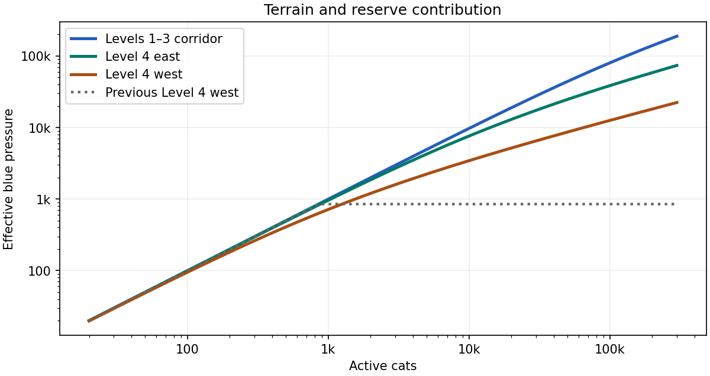

# Milestone 22 · Arcade combat

## Baseline

The matched baseline is `d5e281c`. The one-second traces cover both Level 4 fronts and normal fixed-step cannon strategies on Levels 1–3. Positive frontline velocity is toward the blue castle. Run `node scripts/trace-arcade-combat.js [30|60|120]` for the diagnostic fixtures and `node scripts/simulate-dual.js` for the normal Level 4 cannon policies.

- **Authoritative pressure.** West blue pressure stopped at 850. In the repeated-wave fixture, 5,880 cats at 9 s and 79,810 at 35 s both exerted 850 pressure. Rising red reserves took that same blue force from a 2.6-unit/s advance to a 1.5-unit/s retreat. The right front had two separate thresholds for faster movement at 36,000 and 54,000 cats.
- **Travel.** West and east took 1.38 and 1.88 s after multiplication, respectively. A single-corridor squad launched against the opening frontline takes about 1.73 s. West was already comparable at opening, while east and a west front retreating toward its receiver could feel sluggish. Level 4 now takes about 1.05 and 1.43 s, respectively. Routes, rear handoffs, transfers and flank travel keep their geometry.
- **Tactical constraints.** West supply exceeded the 83 red/s melee cap early and stayed open at all ordinary west positions. Rising opposition is deliberate. With the old pressure ceiling, a sufficiently large blue army could still lose regardless of its size. The new pressure model gives cannon investment a way to hold without changing the final objective.
- **Presentation.** Level 4 melee poses used population ratios, so a numerical blue lead could look like a winning clash during an authoritative retreat. Shield discs also widened into their final silhouette while the formation was still exposed, and the defeat clock could finish the deployment animation. The updated poses use combat pressure and velocity. Shield overlap follows authoritative lock, and defeat freezes deployment progress. Previously, the tick that announced the pushing phase first applied ordinary combat. Full protection took effect on the following tick.
- **Deliberate difficulty.** An unfed crossing can fall, and diverting shots to a barricade consumes reinforcement time. A very late wall request can still lose during march or deployment. The final maneuver still requires the secured wall.

The 7,500-cat west recovery fixture illustrates the difference. The wave launches at 9 s and arrives over the existing approach. By 12 s the old front was advancing at 1.8 units/s with 7,304 cats. The new front was advancing at 5.7 units/s with 7,269. At 35 s the old front was falling back at 2.2 units/s and the new force was still advancing at 2.3 units/s. The untouched crossing can still end the fight if ignored.

## Pressure, damage and territory

We compared a single power law `s × population^e` with a frontage-scaled reserve curve. A power law with a fixed exponent below one compresses even the first few ranks and changes the opening balance when scaled to fit two different widths. Anchoring an exponent of 0.65 at 850 cats on west gave 157 pressure at a population of 100 and 28,520 at 300,000. The frontage curve gives 95 and 22,355 at those populations, with the same 630 at 850. In the wide corridor, an equivalently anchored power law gave 4,209 pressure at 10,000 cats, compared with 9,706 for the frontage curve. The frontage curve preserves the sparse opening and makes width control where diminishing returns become noticeable.

For `p` active cats and frontage parameter `F`, pressure is `2p / (1 + sqrt(1 + p/F))`. The marginal contribution is `1/sqrt(1 + p/F)`, which is positive and falls gradually. The red side uses the same terrain curve and retains its per-level pressure multiplier. Frontage parameters are 80,000 on Levels 1–3, 450 on west and 6,000 on east. These are pressure scales in population units. Only arrived infantry enter this calculation.

Melee deaths use aggregate contact and engagement limits. Blue attack production grows with blue population up to the lane's red casualty rate cap. Red attacks use the smaller contact population and its engagement ratio, with a separate blue casualty rate cap. At the open east entrance, red exposure also limits how quickly fresh defenders can be killed. Each step clamps losses to the actual opposing population. Reserves sustain pressure as the front takes losses. Artillery and arrows keep their own impact damage path.

Signed advantage is the pressure difference divided by the sum. Balanced pressure tends toward a stationary front, and an advantage moves the line toward the weaker side. The free-movement bonus rises smoothly with absolute strength and pressure advantage and falls with opposition. The mode names describe ranges of that bonus for diagnostics. Speed eases toward the target with a 32-unit/s² acceleration limit. Castle and terrain bounds stop motion at their physical limits. The shared corridor stops just short of the flag, leaving the last stretch for the victory charge. The east cutoff requires blue presence at the actual entrance. With approximately four red arrivals/s and a 300,000-cat force starting at y=240, the new model reaches the entrance in about 12 s at sustained speed of 10.3 units/s. The previous committed-army fixture took about 10 s. Ordinary east advance is 5.1 units/s.

## Level 4

West infantry can hold while the player invests in that crossing, freeing room for staggered upgrade decisions. West ordinary advance still stops at the crossing terrain bound without touching the west entrance. East intake rises from 39 at 3.05 cats/s per second of battle, capped at 290. The early cost of splitting cannon attention remains. Barricades retain their 132 / 30 / 30 / 90 hit costs in phalanx, west ×99, east ×99 and east ×999 order.

Meowrtans march, then gradually contribute up to 380 pressure during their 1.15-second deployment. The pushing phase starts on the exact fixed tick that locks shields and makes the left immune to breach. If the castle is crossed earlier, the result names the missed lock. Once secured at the bottleneck, the wall stays in place and ordinary infantry withdraw through the junction. East supply can fall first. The main breakthrough still requires east clearance and a secured wall, after which a flank rounds the ridge and attacks the remaining west force from behind. An exhausted flank clears its last fractional file under contact, so surviving east reserves can make another attempt along the same route.

## Matched results

All values below use a fixed 60 Hz simulation. Rendering at 30, 60 or 120 Hz produces the same authoritative replay within each build. Counts are rounded and times exclude celebratory animation. Final flank duration starts with the last departure when an earlier attempt is defeated. Level 2 and 3 red melee figures exclude the support damage shown separately.

| Level and policy | Outcome and seconds before → after | Blue arrivals | Blue casualties | Red melee casualties | Supply cutoff (s) | Support damage |
| --- | --- | ---: | ---: | ---: | ---: | ---: |
| 1 · Balanced C | Win 92.97 → 87.75 | 359,826 → 302,883 | 197,015 → 180,358 | 153,432 → 129,397 | 89.98 → 82.13 | — |
| 2 · Artillery first | Win 83.30 → 80.78 | 195,531 → 165,561 | 78,288 → 74,592 | 78,881 → 66,972 | 82.37 → 77.67 | 64,178 → 61,352 |
| 3 · Balanced | Win 90.75 → 84.65 | 395,013 → 323,085 | 200,061 → 191,746 | 165,397 → 139,887 | 90.75 → 80.93 | 42,513 → 36,600 |

| Level 4 policy | Outcome and seconds before → after | Blue arrivals | Blue casualties | Red casualties | East cutoff (s) | Deploy / lock / secure (s) | Final flank maneuver (s) |
| --- | --- | ---: | ---: | ---: | ---: | --- | ---: |
| Both ×99, wall, ×999 | Win 132.4 → 111.7 | 402,984 → 284,616 | 23,849 → 17,561 | 26,350 → 21,767 | 110.7 → 91.1 | 50.5 / 51.7 / 56.1 → 50.5 / 51.7 / 54.0 | 11.4 → 12.0 |
| Both ×99, wall, skip ×999 | Win 151.3 → 116.0 | 73,071 → 50,796 | 28,744 → 18,397 | 30,950 → 22,842 | 127.4 → 95.3 | 50.5 / 51.7 / 56.1 → 50.5 / 51.7 / 54.0 | 11.3 → 12.0 |
| Off-center adaptive | Win 136.4 → 109.2 | 390,318 → 227,886 | 26,682 → 16,443 | 27,353 → 21,550 | 112.9 → 89.1 | 54.2 / 55.4 / 61.8 → 54.2 / 55.4 / 59.2 | 12.9 → 13.6 |
| Both ×99, skip wall | Loss 68.4 → survived 240 s | 33,867 → 144,648 | 24,398 → 74,514 | 15,383 → 26,168 | — → 51.7 | — | — |
| Camp east ×20 | Loss 18.9 → 19.5 | 2,220 → 2,340 | 608 → 595 | 2,151 → 2,237 | — | — | — |

The furthest retreat on west in the double-upgrade replay changed from y=441 to y=376. The imperfect replay changed from y=501 to y=424. In the no-wall replay the west never moved further back than y=338 after the change. Its east cutoff left the west supply active and the level unresolved at the replay limit. Sustaining the crossing and finishing the siege are separate accomplishments.

## Portrait evidence

The 390 × 844 recordings use the public selector and cannon touch input. In the west recovery clip, the player feeds the east starter for four seconds, opens west ×99, and keeps firing into that gate. The west retreats at about 10 units/s shortly before the first arrivals and advances at about 3 units/s as the next volleys join. The full Level 4 win also shows a light first flank giving ground and a larger follow-up force completing the encirclement.

| Recording | What to look for |
| --- | --- |
| [A · Level 1](https://github.com/Urqe/RagdollLabs-battlecats/raw/milestone-22-evidence/a-level-1.mp4) | Both upgrades, the ×999 surge, cutoff and victory. |
| [B · West recovery](https://github.com/Urqe/RagdollLabs-battlecats/raw/milestone-22-evidence/b-west-recovery.mp4) | West pulls back, the ×99 columns reach the rear, and the line reverses. |
| [C · Meowrtans](https://github.com/Urqe/RagdollLabs-battlecats/raw/milestone-22-evidence/c-phalanx.mp4) | Unlock, march, deployment, shield lock, push and secured handoff. |
| [D · Level 4 victory](https://github.com/Urqe/RagdollLabs-battlecats/raw/milestone-22-evidence/d-level-4-win.mp4) | Uninterrupted selector-to-victory playthrough with both fronts and the rear attack. |
| [E · Level 4 defeat](https://github.com/Urqe/RagdollLabs-battlecats/raw/milestone-22-evidence/e-level-4-loss.mp4) | East-only investment leaves the west crossing exposed. |
| [F · Purrapult and Meowmen](https://github.com/Urqe/RagdollLabs-battlecats/raw/milestone-22-evidence/f-support.mp4) | Purrapult impacts and the sustained archer barrage, captured from two separate plays. |

[Traces, strategy event digests, and video timings](https://github.com/Urqe/RagdollLabs-battlecats/tree/milestone-22-evidence)

## Canvas performance

Run `node scripts/profile-arcade-combat.js chromium` or use `webkit` in the same command with the local game server running. Each sample draws the real Canvas at 390 × 844 and device scale 2. The harness seeks through the fixed-step replay, then runs live animation frames for each window with video recording disabled. The overwhelming checkpoint uses the four-per-second trickle fixture. Canvas measurements cover synchronous drawing. Frame intervals also include scheduling and composition.

| Phase | Chromium frame p50 / p95 | Chromium Canvas p50 / p95 | WebKit frame p50 / p95 | WebKit Canvas p50 / p95 |
| --- | ---: | ---: | ---: | ---: |
| Small armies | 16.7 / 16.7 | 1.1 / 2.6 | 24 / 44 | 1 / 2 |
| Growing formations | 16.7 / 16.8 | 1.4 / 2.7 | 27 / 53 | 1 / 2 |
| ×999 arrivals | 16.7 / 16.7 | 2.1 / 3.1 | 31 / 51 | 1 / 2 |
| Overwhelming advance | 16.7 / 16.8 | 1.1 / 1.6 | 25 / 53 | 1 / 1 |
| Two fronts | 16.7 / 16.8 | 1.3 / 2.1 | 25 / 53 | 1 / 2 |
| Deployment | 16.7 / 16.7 | 1.5 / 1.9 | 31 / 59 | 1 / 2 |
| Redeployment | 16.7 / 16.7 | 1.3 / 1.9 | 27 / 54 | 1 / 4 |
| Encirclement | 16.7 / 16.7 | 1.4 / 2.2 | 29 / 53 | 1 / 2 |

Times are milliseconds on the Linux host, using Chromium 159 and WebKit 27.2. WebKit had slower frame scheduling than Chromium even at similar Canvas draw times. A concurrent-load run produced much larger frame delays in both engines. The drawing budget still uses bounded representatives, reserve silhouettes and bounded reactions. Physical iPhone performance and first-time-player playtesting remain unverified.
