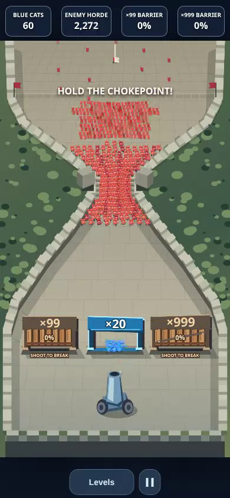
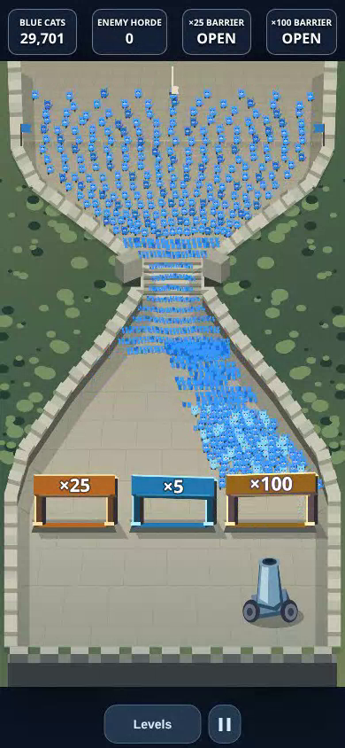
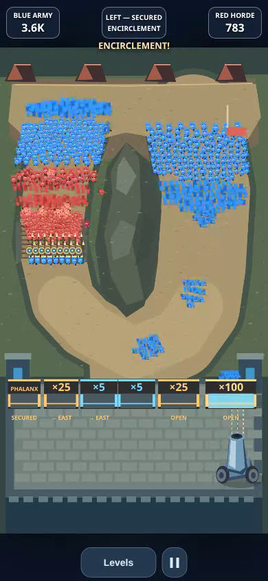

# Milestone 23 — Army scale and individuality

Milestone 22 started Levels 1–3 with an empty blue front and 2,225 red cats. At 390 × 844, the opening red formation drew 231 individual sprites and 232 reserve silhouettes for about 21% representation. The HUD began counting the first 60 blue cats as soon as they entered the march, while the front was still empty. The first arriving files quickly took the active blue force past the old 100-cat literal range. Widening or spreading those ranks can improve legibility, but it cannot show 2,225 opening defenders or 2,997 new cats per volley in this corridor.

Milestone 23 opens the same corridor with 34 blue and 78 red cats. Both appear in ordinary ranks. Fifteen recruits from a full starter volley leave the gate in three files of five, travel toward the rear shoulder, and start contributing when the march completes.

| Rule | Milestone 22 | Milestone 23 |
| --- | ---: | ---: |
| Levels 1–3 opening blue / red | 0 / 2,225 | 34 / 78 |
| West opening blue / red | 300 / 570 | 38 / 81 |
| East opening blue / red | 615 / 660 | 48 / 92 |
| Gate multipliers | ×20 / ×99 / ×999 | ×5 / ×25 / ×100 |
| Full three-shot volley | 60 / 297 / 2,997 | 15 / 75 / 300 |
| Red intake at start, Levels 1–3 | 150/s | 13.5/s |
| Red intake growth, Levels 1 / 2 / 3 | 34.1 / 38 / 55 | 3.069 / 3.42 / 3.861 |
| Red intake cap, Levels 1–3 | 3,200/s | 288/s |
| Red intake cap, west / east | 800 / 290 | 128 / 48 |
| Frontage, main / west / east | 80,000 / 450 / 6,000 | 2,400 / 72 / 960 |
| Melee red casualty cap/s, main / west / east | 4,400 / 83 / 235 | 343.2 / 13.28 / 48 |
| Melee blue casualty cap/s, main / west / east | 24,000 / 340 / 900 | 1,872 / 54.4 / 144 |
| Purrapult damage limit / pocket floor | 3,400 / 550 | 235 / 38 |
| Meowmen maximum damage per volley | 150 | 6 |
| Level 4 wall / west / east / siege barricade hits | 132 / 30 / 30 / 90 | 132 / 30 / 30 / 51 |
| Level 4 wall deployment pressure / red queue capacity | 380 / 1,700 | 60.8 / 272 |
| Full individual range, corridor / normal crossing | 100 / 100 | 150 / 112 |

## Experiments and strategy

We reused cannon policies and recorded fixed-step outcomes on all four levels. The aggressive candidate used ×3/×10/×50, 22 blue and 48 red in the corridor, and started the crossings at 22/42 west and 28/54 east. The moderate candidate used the selected corridor populations and gates. The original renderer was used for the comparison of population configurations. The selected build then applies the wider individual range and raises east intake and casualty capacity relative to the moderate candidate. The west remains narrower and accumulates opposition if the player delays the wall.

| Matched policy | Baseline time / peak blue | Moderate time / peak blue | Aggressive time / peak blue | Selected time / peak blue |
| --- | ---: | ---: | ---: | ---: |
| 1 · Balanced C | Win 87.75 s / 122,525 | Win 93.60 s / 24,337 | Win 29.45 s / 735 | Win 93.60 s / 24,337 |
| 2 · Artillery first | Win 80.78 s / 90,969 | Win 52.63 s / 2,039 | Win 26.57 s / 222 | Win 52.63 s / 2,039 |
| 3 · Balanced | Win 84.65 s / 131,340 | Win 95.73 s / 29,692 | Win 31.90 s / 533 | Win 95.73 s / 29,692 |
| 4 · Adaptive with missed shots | Win 103.23 s / 115,649 east | Win 67.73 s / 1,901 east | Win 69.27 s / 662 east | Win 69.47 s / 1,910 east |

- **The Last Stand.** Starter camping still loses. The aggressive candidate allows it to win in 22.62 s. Sustained ×25 can now win if used early enough. Diverting shots toward ×100 can expose the line, and the balanced C policy uses the arriving ×100 wave to reverse a late retreat. In that replay the first and last barricades open at 17.12 and 56.87 s. Supply closes at 92.25 s. Blue and red melee losses average about 169 and 153 per second, down from 2,055 and 1,475.
- **The Purrapult.** The area pocket still limits casualties on first contact, and its flight and reload remain the same. The impact animation uses force relative to the weapon's damage budget. Artillery first clears the route with one gate upgrade and about 1,538 artillery casualties. Gates first can win with both upgrades. Shooting the crew barricade and ignoring the infantry still loses.
- **The Meowmen.** The six-arrow cadence is unchanged. Each arrow can remove one cat. Early archer support and sustained ×25 can win before the final upgrade, while balanced investment can still build to ×100. Support alone loses.
- **A Tale of Two Tails.** West and east have independent intake, pressure and losses. The wall still locks on its authoritative deployment tick and sends surviving infantry east. Camping either crossing loses. Balanced policies can win with or without the optional siege gate. Skipping the east ×25 leaves a much longer fight, even if the player eventually opens ×100. With no wall the east can make progress, but it cannot begin the final encirclement. The wall, withdrawal, transfer, cutoff, flank and rout are checked in order and by population ownership.

The balanced Level 1 replay increases mean representation from 26% to 47% on blue and from 6% to 45% on red. The same policy has roughly 14 seconds of fully individual blue formations and 5 seconds on red, up from no whole-second samples in either range. The moderate candidate with the old renderer gives about eight and two seconds respectively. These are active-formation estimates sampled once per simulated second, with transit excluded. Failed or empty fronts do not count as seconds of one-to-one representation.

## Presentation

An ordinary field slot corresponds to one position in a center-out rank. Front ranks, shoulders and rear slots have deterministic coordinates and individual stride phases. Growth follows that slot order and opens the spacing gradually. Losses contract the occupied edge, while an event-backed fall and local refill impulse show the loss at contact. Purrapult and arrow reactions reuse the airborne pool. Returning cats substitute for their living slots during knockback.

Through 150 cats in the corridor or 112 per normal crossing formation, the occupied field budget is the rounded-up active count. A partially depleted final cat occupies a slot while its remaining population is positive. Above the local threshold, front ranks continue to add slots toward the cap and the rear grows with cached silhouettes. No field slots are reassigned when the reserve starts. The main corridor allows up to 252 close slots and 720 reserve silhouettes per team. At the crossings, ordinary fields use a 144-slot ceiling and a 588-silhouette reserve ceiling. The contact around the ridge and the rear attack have smaller budgets to fit the terrain.

The camera, seam, flight and handoff affect the number of complete atlas draws on any instant. A reserve tile paints up to six silhouettes. Starter files are individual. Medium files keep up to 20 travelling cats per projectile. The largest wave uses a dense column, and older overlapping corridor files use grouped stamps to keep the newest files and the line readable. The HUD includes marching and transferring troops. Only those that have arrived participate in pressure and losses. The same aggregate fixed-step combat model drives all levels.

## 390 × 844 evidence

| Milestone 22 opening | Milestone 23 opening |
| --- | --- |
|  |  |

| First reinforcement | Victory advance |
| --- | --- |
|  |  |



The recordings use public level selection and cannon drag controls. The early HUD in both opening screenshots includes the first volleys already on the way. The selected victory still shows in-transit cats in the HUD. The clips and timing JSON are kept outside Git.

## Rendering and performance measurements

The opening count can be checked directly in both engines. In Level 1 the original red atlas tile averaged 15 CSS pixels wide and occupied 19 vertical and 17 horizontal bins. The new red tile averages 17 pixels, with eight vertical and 13 horizontal bins. Summed atlas area falls from 15.8% to 7.0% of the viewport. The blue opening uses 34 tiles, four vertical and 17 horizontal bins, and 3.3% viewport area. These are occupied position bins including movement, at an eight-world-unit row interval and a ten-unit column interval. They estimate screen coverage even when the visible ranks stagger or overlap.

| Opening | Blue active / individual / silhouettes | Red active / individual / silhouettes |
| --- | ---: | ---: |
| Level 1, baseline | 0 / 0 / 0 | 2,225 / 231 / 232 |
| Level 1, selected | 34 / 34 / 0 | 78 / 78 / 0 |
| Level 4, baseline | 915 / 288 / 233 | 1,230 / 288 / 313 |
| Level 4, selected | 86 / 86 / 0 | 173 / 173 / 0 |

At the selected Level 1 peak, batching older overlapping reinforcement files preserves 2,387 blue impressions and brings standalone blue atlas draws from 1,775 in the unbatched prototype to 431. The remainder are reserve or travelling silhouettes. The 23,000–30,000 peak armies in the balanced corridor replays still require abstraction. The redesigned scale spends its larger individual sprite budget on the opening and uses the stamp atlas for the dense rear and older marching files.

The profiling reports include active populations, visible sprite submissions, silhouette counts, atlas size, occupied bins and density at each reached checkpoint. The opening counts for Levels 2 and 3 also include their two- and six-cat support crews in the blue draw totals. At later checkpoints the draw totals include combat reactions and transit. Use the simulation report for the active-force representation ratio.

The paired runs below use Chromium 156 and WebKit 26 on the shared Linux host. Each cell gives Canvas p50/p95 followed by animation-frame p50/p95 in milliseconds. WebKit produced fewer samples before the capture window expired. Its Level 4 opening produced fewer than four samples per build, so that row omits those timing estimates.

| Scene | Chromium M22 | Chromium M23 | WebKit M22 | WebKit M23 |
| --- | ---: | ---: | ---: | ---: |
| Level 1 opening | 3.2/8.8 · 49.9/83.4 | 1.6/13.3 · 49.9/83.3 | 4/13 · 210/302 | 2/36 · 251/303 |
| First reinforcement | 8.3/15.4 · 50/100 | 7.8/26.3 · 100/150 | 3/13 · 224/296 | 18/36 · 336/354 |
| Near the literal limit | 8.3/24.2 · 50/66.7 | 6.4/14.5 · 66.6/150 | 3/13 · 197/296 | 12/36 · 323/338 |
| Transition to reserve ranks | 7.6/41.5 · 50/83.3 | 5.8/35.9 · 66.6/133.4 | 6/13 · 201/228 | 12/14 · 297/377 |
| Largest gate wave | 11.7/40.4 · 66.7/133.4 | 6.2/26.6 · 83.3/133.3 | 12/17 · 327/396 | 4/44 · 355/398 |
| Level 1 peak | 21.9/68.9 · 216.7/400 | 4.1/22.9 · 83.4/200 | 42/64 · 310/358 | 10/22 · 372/424 |
| Level 4 opening | 5.2/8 · 33.4/100 | 1/3.6 · 16.7/33.4 | — | — |
| Phalanx deployment | 3.3/16.2 · 83.4/166.6 | 7.4/42.3 · 50/100 | 19/20 · 408/495 | 8/14 · 204/284 |
| Encirclement | 9.9/39.2 · 66.6/150.1 | 6.5/15.3 · 50/66.7 | 28/42 · 399/554 | 3/12 · 284/344 |

The paired runs show less Canvas work at peak, and frame intervals vary substantially in both builds under shared-host load. An earlier, less contended Chromium run without march batching measured 16.7/16.8 ms in the new Level 1 opening and 33.3/50 ms at peak. The aggressive candidate's much smaller peak cost 1.1/6.3 ms of Canvas time, against 7.7/29.3 ms for the moderate candidate in the candidate runs. These observations informed the reserve batching decision. Physical Safari performance is open.

Chromium exposed an approximate JavaScript heap size, with about 4.1 MB at the new Level 1 opening and 6.6 MB at peak in the full report. The matching baseline phases were 3.7 and 6.7 MB. WebKit did not expose that field. These samples cover the JavaScript heap and leave Canvas surfaces, atlases and GPU allocations unmeasured.

## Reproduction

From a checkout at this milestone, run the commands below. Keep the unchanged baseline in a separate worktree.

```sh
git worktree add --detach /tmp/siegedolls-m22 4039549
npm ci
node scripts/compare-army-scales.js 60 baseline /tmp/siegedolls-m22
node scripts/compare-army-scales.js 60 moderate /tmp/siegedolls-m22
node scripts/compare-army-scales.js 60 aggressive /tmp/siegedolls-m22
node scripts/compare-army-scales.js 60
npm test
npm run test:browser
```

Run `npm run dev` in a second terminal. Use `node scripts/capture-arcade-combat.js test-results/individuality a d f` to record Level 1, Level 4 and the support clips. Use `node scripts/profile-army-individuality.js chromium test-results/individuality-stills` and substitute `webkit` for the second engine. Set `SIEGE_URL` to point the profiler at another checkout. To profile a candidate with the current renderer, set `PROFILE_CANDIDATE=moderate` or `PROFILE_CANDIDATE=aggressive` and `PROFILE_BASELINE=/tmp/siegedolls-m22`. Use `PROFILE_CHECKPOINTS=opening,peak` for a short comparison. It samples up to 24 steady draws per reached checkpoint at device pixel ratio 2, with the replay frozen for each sample to keep the workload comparable. The timings measure Canvas draw submission and animation callback intervals. Atlas bounds include transparent margins. Counts include visible marching and reacting cats, and the support crew. Density estimates sum atlas bounds and therefore include overlaps. A physical iPhone Safari playtest is still the product-performance gate.
