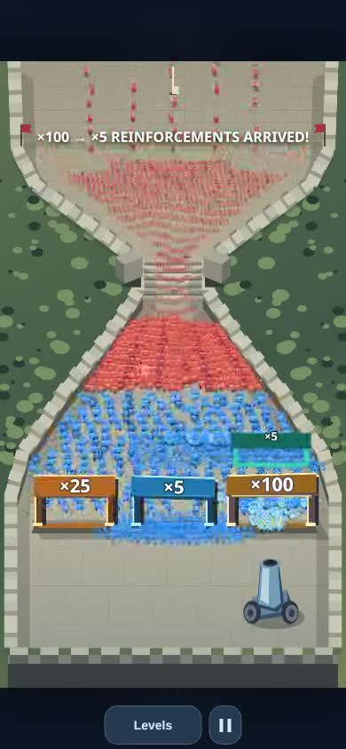
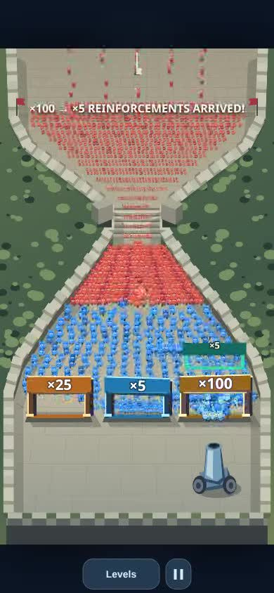

# Living Reinforcements & Soldier Continuity

## Milestone 24 diagnosis

- Field and reserve positions used a periodic `crowdFlow` term multiplied by pressure. This sent recurring displacement through successive ranks whenever the army moved. The dense contact seam and column positions also used a running clock. Reserve tile centers had a separate row-phased stride.
- Arrival was credited on the simulation's fixed tick. The renderer then allocated only the extra detailed and reserve slots created by that credit. A full formation could grant zero slots. Distant handoffs used an opacity crossfade, assigned sprites reverted to generic slot appearance after interpolation, and the remaining marching tail faded on a timer.
- The relay recomputed existing representatives from the second gate, including those still behind it, and generated extra reserve stamps whose lifetime ended with the tail. Receiver geometry could clamp successive ranks to one shoulder position and push a still-visible column into growing resident ranks.

## Presentation and handoff

Army occupation still follows the live contact line, terrain width, troop mass and directional pressure. The rank anchors follow the front with depth-dependent lag. The seam and column irregularities are fixed in space. Individual gait, contact exchanges, knockbacks and casualty reactions still animate.

A marching representative is identified by its cohort object and member index. It keeps its tint and gait phase through arrival and while occupying a resident slot. Existing representatives retain their paths at the relay. Sixteen additional representatives per projectile cohort release from the relay plane, so a full compound volley can carry 144 detailed cats when all three squads have detail. The simulation still credits 500 cats per projectile and 1,500 per volley.

The arrival event supplies an immutable snapshot of the route and a reference to the marching cohort. Only the presentation keeps a cache of the last drawn world position. Arrivals claim new field slots first and reserve slots behind them. When field capacity has saturated, the reserve allocator uses available rear slots. A claimed slot draws its owner once, from its last marching pose toward its destination at up to 135 world units per second. Reaching the destination ends integration and the representative retains the slot. The eight-second tail limit is a safety cap for outstanding drawing work.

Blue field representatives keep their last world positions. An authoritative loss opens a file and the cats behind that vacancy move up from their previous positions. A named reserve can take the last place in that file. Existing red reactions and localized replenishment still respond to real losses. Flying Fur, artillery, and archer flight and retirement effects continue to use their existing simulation events.

The shared single-corridor renderer uses at most 252 field slots and 1,560 reserve places per side. Most reserve places are batched in stamps of six. Blue may detail up to 144 reserve owners. Up to 18 arrived cohorts remain eligible for tail drawing. The six newest approaching cohorts are eligible for detailed marching cats, and older distant high-multiplier cohorts can use stamps. A ×5 cohort uses five representatives and ×25 uses 25. Army size and combat are still computed exclusively from aggregate state.

## Portrait evidence

The gameplay recordings use the level selector and one-finger cannon input at 390 × 844, DPR 2. The population HUD is hidden. Gate labels, in-game messages and the result screen are visible. The stationary fixture pins both sides at 10,000, holds the contact line at y=335 and sends no reinforcements.

| Before compound arrival | After compound arrival |
| --- | --- |
|  |  |

| Check | Recording and time |
| --- | --- |
| A. Dense-army movement | [Matched stationary baseline](evidence/living-reinforcements/stationary-before.mp4) and [matched stationary correction](evidence/living-reinforcements/stationary-after.mp4). For movement during combat, compare [baseline Level 1](evidence/living-reinforcements/level-1-before.mp4) at about 0:54–1:12 with the [corrected run](evidence/living-reinforcements/level-1-victory.mp4) at about 0:58–1:18. |
| B. Small lifecycle | [Corrected Level 1, 0:01–0:06](evidence/living-reinforcements/level-1-victory.mp4#t=1,6). ×25 waves follow the opener. |
| C. Compound lifecycle | [Corrected Level 1, 1:01–1:13](evidence/living-reinforcements/level-1-victory.mp4#t=61,73). The first compound columns are visible around 1:02, reach the army at about 1:03 and feed the advance. |
| D. Contact defeats and replenishment | [Corrected Level 1, 0:04–0:13](evidence/living-reinforcements/level-1-victory.mp4#t=4,13). Watch the first blue ranks and the cats behind them. |
| E. Large-army battle | [Corrected Level 1, 1:03–1:20](evidence/living-reinforcements/level-1-victory.mp4#t=63,80). Red peaks above 22,000 as blue reverses the front and breaks through the crossing. |
| F. Complete victory | [Corrected Level 1 from selector to victory](evidence/living-reinforcements/level-1-victory.mp4). The result occurs at 76.75 game seconds in this recording. |
| G. Levels 2–4 | [Purrapult support](evidence/living-reinforcements/level-2-purrapult.mp4), [Meowmen support](evidence/living-reinforcements/level-3-meowmen.mp4), and [Level 4 withdrawal, redeployment, encirclement and victory](evidence/living-reinforcements/level-4-encirclement.mp4). |

The baseline full run covers early squads around 0:02, growing ranks around 0:05 and 0:29, the large red occupation around 0:55, the first compound gate and arrival around 0:57–1:00, and the advancing blue line from 1:00 onward. Wall-clock input can vary between the two manual-control runs. The pinned fixture and strategy comparisons use identical inputs.

## Validation

- `npm test` passed all 25 test files, including ten seconds of stationary reserve positions, relay identity, bounded and exclusive slot ownership, near and distant handoffs, replenishment, and pause and reset behavior.
- Chromium passed all 18 Playwright checks. WebKit ran the portrait smoke, archer and pause checks.
- `node scripts/compare-ocean.js` produced byte-identical output at 30, 60 and 120 Hz. Output SHA-256 is `32a31d2452a7a990ec37a480fcce6a3885f0a7aa166f15e045efbb5a90ef58fe`. Comparisons cover compound arrivals, casualties, pressure-driven territorial change, supply cutoff and the win/loss result. The presentation tests also compare games with and without motion listeners across those rates.

## Canvas performance

The table compares Milestone 24 at `da5e382` with this revision. Each cell gives draw p50/p95 and frame interval p50/p95 in milliseconds. Measurements used headless Chromium 156 and Linux WebKit at 390 × 844, DPR 2, with 18 frame samples per row. Populations are per side. The overlap fixture starts at 10,000 per side with two compound volleys marching and another volley just credited. It updates presentation while sampling. The short samples characterize this environment and show some variation in tail latency.

| Cats per side | Chromium before | Chromium after | WebKit before | WebKit after | Detailed cats + reserve silhouettes per side |
| ---: | ---: | ---: | ---: | ---: | ---: |
| 100 | 0.7/2.5 · 16.7/16.7 | 0.5/0.8 · 16.7/16.8 | 1/1 · 16/33 | 1/1 · 16/35 | 100 + 0 |
| 300 | 0.9/4.6 · 16.7/33.3 | 0.9/2.1 · 16.7/16.7 | 1/3 · 17/37 | 1/2 · 16/39 | 206 + 41 |
| 1,000 | 0.9/2.3 · 16.7/16.7 | 0.9/3.1 · 16.6/16.8 | 1/2 · 19/40 | 1/1 · 17/41 | 250 + 155 |
| 3,000 | 1/3.1 · 16.7/16.8 | 1/3.3 · 16.7/16.7 | 1/1 · 20/41 | 1/1 · 19/43 | 251 + 291 |
| 10,000 | 1/1.2 · 16.7/16.7 | 1.2/6 · 16.7/16.7 | 1/2 · 32/49 | 1/1 · 20/42 | 252 + 794 |
| 30,000 | 1.3/2.6 · 16.7/16.8 | 1.2/14 · 16.7/16.7 | 1/4 · 32/61 | 1/2 · 24/45 | 252 + 1,348 |
| 100,000 | 1.4/4.5 · 16.7/49.9 | 1.3/2.8 · 16.7/16.7 | 1/2 · 24/45 | 1/2 · 22/48 | 252 + 1,558 |
| 10,000 with compound overlap | 1.9/3.9 · 16.7/33.4 | 2/4.1 · 16.7/33.4 | 2/5 · 30/48 | 2/5 · 29/77 | Blue 542 + 1,656 before and 687 + 672 after |

Chromium reported about 2.6–3.7 MB of JS heap during the static checkpoints and 3.22 MB before versus 3.27 MB after in the overlap check. WebKit did not expose JS heap use. The draw timings measure JS-side Canvas calls. The frame intervals also include browser rendering and scheduling. WebKit's overlap frame p95 rose from 48 ms to 77 ms in this sample despite unchanged draw p95.

Run `node scripts/profile-ocean.js chromium` and `node scripts/profile-ocean.js webkit`. Set `PROFILE_COMPOUND=1` for the overlap fixture and `SIEGE_URL` for the baseline server. Reproduce the normal touch playthroughs with `HIDE_HUD=1 node scripts/capture-arcade-combat.js test-results/living a d f`.

## Known limitations

At saturated capacity some representatives join batched reserves at the shoulder. Tracking a particular cat becomes harder amid several overlapping volleys. The Level 4 renderer shares the stationary crowd geometry and keeps its own established transfer routes and receiving blend. It does not share the single-corridor persistent roster. Levels 2–3 clips show the support mechanics in action, and the browser suite covers their victory behavior. Physical iPhone Safari performance remains unverified.
