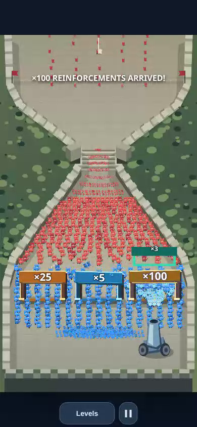

# Milestone 24 — Ocean of Cats

## Baseline and rendering

The comparison starts at `05f50a2`, which includes the Milestone 23 renderer and the territorial crowd movement principle. Milestone 23 capped the corridor at 252 detailed slots and 720 reserve silhouettes per side. In the 30,000-versus-30,000 diagnostic, the red reserves covered a narrow block with a gap between it and the detailed ranks. Blue reached the width of the lower yard, but its rear formation ended partway through the yard. At 100,000 the fields hardly grew.

The selected renderer keeps one-to-one detail through 150 active cats in the main corridor and 112 per normal crossing. The same deterministic slots still handle footfall variation, casualty recoil, artillery gaps, arrow reactions, and arrival handoffs. Supporting cat ranks spread across the usable lane as the formation increases. Reserve ranks use the existing six-cat atlas, with ear and face detail painted into the cache. Stable center-out indices, alternating lateral stagger and staggered stride phases break up repetition. The cache builds once per renderer.

The rear footprint uses the live frontline, the legal rear edge, and a logarithmic share of the available depth. Reserve count increases smoothly after 3,000 cats, from the original 291 at 3,000 to 1,348 at 30,000. The blue receiver follows the occupied rear rows. An eased presentation population and the existing reserve extent interpolation spread that growth over several frames. A retreating side compresses its reserve reach by up to 17%, weighted by velocity and pressure advantage. As the line moves, its available depth changes with it.

The contact seam uses a deterministic wave up to 4.6 world units away from the authoritative line. It fades toward the corridor edges and combines with the existing exchanges and impact gap. Terrain width is sampled across the height of each reserve tile to keep the visible crowd within the sloping walls. Level 4 derives depth separately for each crossing and the rear encounter, using each branch’s center, frontage and legal rear depth. This lets the attacking flank and the Meowrtan wall compress the remaining red positions from opposite directions. Simulation casualties, pressure, supply and victory still belong to aggregate combat.

We considered increasing detailed slots alone and stretching the old reserve bands. A larger detailed grid increases per-frame work and makes the same cat pattern more visible. Stretching the old tile budget opens empty gaps in a larger yard. Growing reserve depth and the cached tile budget together gives 30,000 a substantially bigger footprint, and the curve saturates at 1,560 silhouettes per side. Crossing-specific caps are smaller. Very large forces keep their scale through approaching waves and motion once the yard fills.

### HUD-hidden scale check

These are fixed-population diagnostics at the same frontline and camera. The normal-control footage covers the actual changes in position and outcome.

| 300 per side | 3,000 per side | 30,000 per side |
| --- | --- | --- |
|  |  |  |

[Milestone 23 at the same 30,000-per-side setup](evidence/ocean-of-cats/baseline-30000.png)

## Playable compound gate

Level 1 uses the existing right barricade. Its 231 direct hits unlock the ×100 gate and the green downstream ×3 relay. The other two gates still give 15 and 75 cats per full volley. The right route gives 300 on the first crossing and 900 after a full three-cohort crossing of the relay. The relay is visible from the start and lights up with the route. The shared unlock keeps the choice on the existing three cannon paths and adds a second crossing without a new control. A coloured pulse and a widening column show the second multiplication.

A cannon volley keeps three projectile slots with one shared volley ID. Its first gate consumes each projectile and creates one aggregate cohort per slot. The cohort carries its origin, blue destination, marching progress, integer count and gate history. A forward sweep picks the closest physical eligible plane for the previous gate’s route. Overlaps at one plane choose one gate, and a recorded ID cannot apply a second time. Any receiving line that the cohort meets first takes precedence over a relay deeper on the route. That distinction matters when the enemy reaches the gates. A relay may open while a cohort is approaching. Marching cats have no combat losses until arrival.

Each multiplication checks the product for a positive safe integer. Arrival rejects an active total beyond the safe integer range. A ×99 → ×99 test verifies 29,403 cats across one full volley. Incoming squads only contribute to combat after arrival. Existing clocks pause and reset the travelled distance, and switching level clears both the cohort list and relay flashes. Levels 2–4 keep their own gates and support routes.

The relay paints a larger fan of detailed cats plus bounded cached groups. Old overlapping waves use the existing grouped drawing path. Stage magnification changes the visual release timing while the aggregate march continues at its usual speed.

## Balance comparison

The combat model and red intake stay at their Milestone 23 settings. A faster late red intake was also tried. Raising growth from 3.069 to 3.8 brought the red peak above 5,000 in policy C but caused policy D to lose before the final unlock. The selected change spends the more powerful reinforcement on the established right-route investment. Starter camping still loses in 53.13 s and a right barricade rush in 19.48 s. Early ×25 investment can still win without taking the relay.

| Balanced policy C | Complete volley | Gate unlock | First relay | Peak blue / red | Supply cutoff | Victory |
| --- | ---: | ---: | ---: | ---: | ---: | ---: |
| M23, ×100 direct | 300 | 56.87 s | — | 24,337 / 3,495 | 92.25 s | 93.60 s |
| Candidate ×100 → ×2 | 600 | 56.87 s | 63.35 s | 46,519 / 3,495 | 88.98 s | 90.87 s |
| Selected ×100 → ×3 | 900 | 56.87 s | 63.35 s | 68,281 / 3,495 | 87.40 s | 89.55 s |
| Stress candidate ×100 → ×8 | 2,400 | 56.87 s | 63.35 s | 164,668 / 3,495 | 84.27 s | 87.02 s |

The high candidate more than doubled peak population relative to the selected chain for about 2.5 seconds of battle duration. The ×3 relay leaves a visible contest before breakthrough and preserves the option to win through sustained ×25. The first relay can occur well after the barrier opens if the frontline intercepts the first marching cohorts.

## Portrait measurements

Matched headless Chromium 156 and WebKit 26 runs used a 390 × 844 viewport at device pixel ratio 2. Both sides started at the stated population and the same contact line. Occupied area estimates the union of atlas rectangles on an eight-world-unit grid and includes transparent margins. The files in the evidence archive also include width, depth, density and sprite submission counts separately for red and blue.

| Cats per side | Detailed / reserve per side, M23 → M24 | Red area, CSS px² | Blue area, CSS px² |
| ---: | ---: | ---: | ---: |
| 30 | 30 / 0 → 30 / 0 | 4,028 → 4,028 | 5,187 → 5,187 |
| 100 | 100 / 0 → 100 / 0 | 7,339 → 7,339 | 13,796 → 13,796 |
| 300 | 206 / 41 → 206 / 41 | 15,838 → 15,451 | 32,448 → 32,117 |
| 1,000 | 250 / 155 → 250 / 155 | 24,557 → 21,246 | 44,423 → 40,781 |
| 3,000 | 251 / 291 → 251 / 291 | 28,088 → 23,784 | 49,886 → 43,705 |
| 10,000 | 252 / 486 → 252 / 794 | 33,386 → 37,966 | 55,736 → 59,874 |
| 30,000 | 252 / 648 → 252 / 1,348 | 36,808 → 50,879 | 60,536 → 78,085 |
| 100,000 | 252 / 719 → 252 / 1,558 | 38,297 → 55,404 | 62,578 → 82,886 |
| 300,000 | 252 / 720 → 252 / 1,560 | 38,297 → 55,404 | 62,578 → 82,886 |

At 30,000, the red footprint grew from about 215 × 280 to 321 × 286 CSS pixels. The blue footprint grew from about 332 × 271 to 346 × 311. At medium counts the new reserves emphasize a tighter shoulder. At the 300,000 saturation point the visible area is stable.

Canvas submission p50/p95 and frame interval p50/p95 are in milliseconds. Each population sample below contains 18 measured animation callbacks.

| Cats per side | Chromium M23 | Chromium M24 | WebKit M23 | WebKit M24 |
| ---: | ---: | ---: | ---: | ---: |
| 30 | 0.6/7.3 · 16.7/33.3 | 0.7/2.7 · 16.7/16.8 | 2/6 · 61/79 | 1/5 · 42/71 |
| 100 | 0.8/3.4 · 16.7/33.3 | 0.7/3.4 · 16.7/16.8 | 1/6 · 78/95 | 1/6 · 62/73 |
| 300 | 1.4/3.5 · 16.7/33.3 | 1.1/3.1 · 16.7/16.7 | 3/7 · 100/144 | 2/8 · 72/81 |
| 1,000 | 1.1/3.5 · 16.7/16.7 | 1.5/6.3 · 16.7/33.4 | 3/9 · 99/142 | 2/7 · 74/89 |
| 3,000 | 1.3/1.8 · 16.7/16.7 | 2.8/4.2 · 16.7/16.8 | 5/11 · 104/155 | 3/35 · 82/91 |
| 10,000 | 1.2/1.5 · 16.7/16.7 | 1.2/1.7 · 16.7/16.7 | 4/12 · 95/137 | 3/7 · 89/100 |
| 30,000 | 1.2/1.8 · 16.7/16.7 | 1.5/2.2 · 16.6/16.8 | 3/7 · 81/107 | 4/7 · 60/92 |
| 100,000 | 1.3/2.4 · 16.7/16.8 | 1.7/4.4 · 16.7/33.3 | 2/39 · 80/101 | 4/13 · 60/114 |
| 300,000 | 2.1/4.5 · 16.7/16.7 | 1.7/2 · 16.7/16.7 | 2/6 · 80/91 | 3/7 · 49/70 |

| Actual replay checkpoint | Chromium M23 → M24 | WebKit M23 → M24 |
| --- | ---: | ---: |
| First large gate wave / first compound crossing | 4/11.1 · 50.1/83.4 → 3.8/10.5 · 33.3/66.7 | 5/27 · 269/333 → 6/19 · 82/179 |
| Level 4 encirclement | 4.1/14.3 · 66.7/216.6 → 2.1/7.1 · 16.7/66.7 | 26/53 · 298/368 → 12/36 · 265/313 |

The first compound checkpoint drew 459 blue and 280 red standalone figures plus 570 blue and 264 red silhouettes, including recruits in transit. The Level 4 checkpoint drew 304 blue and 145 red standalone figures plus 368 blue and 174 red silhouettes. Both scene samples use steady redraws of fixed-step replay checkpoints. Chromium’s approximate JavaScript heap reading was 2.1 → 2.2 MB at 30 cats per side and 3.2 → 2.8 MB at 300,000. WebKit omitted it, and neither engine’s sample measures retained Canvas or graphics allocation. Timing varied on the Linux host, particularly during the software WebKit runs. These results show the work stays bounded, with physical iPhone Safari frame delivery still to validate.

## Verification and evidence

Run `npm test` for compound ownership, overlap, unlock, reset, pause and determinism, and the existing support, route, and outcome tests. `node scripts/compare-ocean.js 30` takes a display rate of 30, 60, or 120 Hz. All three reports matched byte-for-byte. The full campaign regression suite covers the existing single-corridor support battles and connected Level 4 endgame.

Chromium and WebKit passed the smoke and archer fixtures. Chromium passed the full Level 1 playthrough with an in-flight 300-cat cohort and two recorded crossings. The uninterrupted touch recording also reached victory. The full WebKit playthrough suite was outside this check.

| Widest contested section | Blue advances up the lane |
| --- | --- |
|  |  |

These frames came from the normal game recording, with only the HUD masked for review. The gameplay archive contains 390 × 844 touch play from the normal level selector. Its clips cover opening growth, the relay, the red occupation, territorial advance, overlapping compound waves, an uninterrupted victory, and Levels 2–4. The large recordings and raw performance reports are kept outside Git in `SiegeDolls-M24-evidence.zip`. Clip D shows the line advancing from approximately y=487 to y=133. Clip E carries more than 10,000 cats across overlapping relay cohorts near its end. The 29,403-cat single volley was an arithmetic test.

```sh
npm ci
npm run dev
CHROMIUM_PATH=/usr/bin/chromium node scripts/profile-ocean.js chromium test-results/ocean
node scripts/profile-ocean.js webkit
node scripts/compare-ocean.js 60
node scripts/capture-arcade-combat.js test-results/ocean-gameplay a d f
```

Set `SIEGE_URL` to the HTTP server of the unchanged baseline worktree to reproduce the matched profiles. For actual relay and flank checkpoints, run `PROFILE_LEVELS=1,4 PROFILE_CHECKPOINTS=compound-wave,encirclement node scripts/profile-army-individuality.js chromium`. Use `large-wave,encirclement` on the baseline and substitute `webkit` for WebKit.
